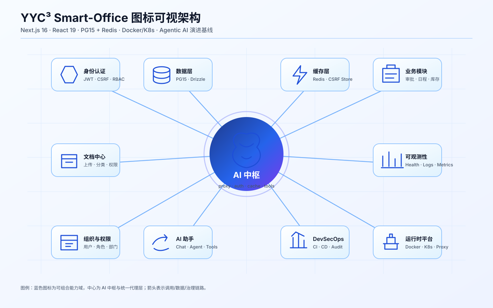
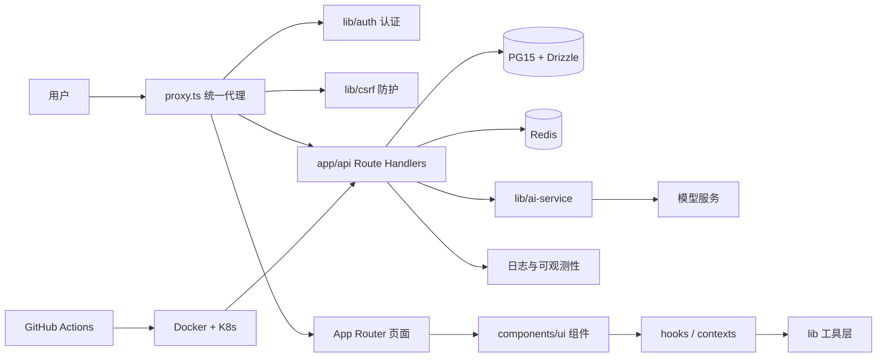

# YYC³ 开发者指南 — 项目概述与图标可视架构

> **_YYC³_**（YanYuCloudCube™ · 注册商标）
> _言启象限 | 语枢未来_
> **_Words Initiate Quadrants, Language Serves as Core for Future_**
> _万象归元于云枢 | 深栈智启新纪元_
> **_All things converge in cloud pivot; Deep stacks ignite a new era of intelligence_**

---

## 核心理念

**五高架构**：高可用 | 高性能 | 高安全 | 高扩展 | 高智能
**五标体系**：标准化 | 规范化 | 自动化 | 可视化 | 智能化
**五化转型**：流程化 | 数字化 | 生态化 | 工具化 | 服务化
**五维评估**：时间维 | 空间维 | 属性维 | 事件维 | 关联维

---

## 一、项目概述

YYC³ Smart-Office 是面向企业办公协同的智能化 Web 应用，采用 Next.js 16 App Router 单包架构，覆盖身份认证、组织权限、审批日程、文档库存、客户跟进、AI 助手与系统健康诊断等业务域。

| 维度 | 当前基线 |
| ---- | ---- |
| 框架 | Next.js 16.4.6（Turbopack）、React 19.3.1、TypeScript 5.9 |
| 数据 | PostgreSQL（团队基线 PG15）+ Drizzle ORM；Upstash Redis 用于 CSRF/缓存 |
| 运行时 | Node ≥ 20.9.0，推荐 20.19.5；pnpm 10.4.1 单包 |
| 样式 | Tailwind CSS 4.3.5 + shadcn/ui + Radix UI |
| 测试 | Jest 30.5.2 + Testing Library；核心逻辑覆盖率 ≥ 80% |
| 质量 | ESLint 9 扁平配置、TypeScript strict、`pnpm run audit`、Next 16 生产构建 |
| 部署 | Docker standalone + Kubernetes + GitHub Actions CI/CD |
| 安全 | JWT + CSRF + bcrypt + Zod + proxy 代理层 + 环境变量/Secret 注入 |

核心目标：在保持 PG15 + Redis 自研数据架构与单向依赖规范的前提下，提供可审计、可回滚、可演进的智能办公能力底座。

## 二、目录与职责速览

| 目录 | 职责 |
| ---- | ---- |
| `app/` | App Router 页面与 Route Handlers，业务入口层 |
| `components/` | 业务组件与 `ui/` 基础组件 |
| `hooks/` | 可复用 React Hooks |
| `contexts/` | 全局上下文（如 AuthContext） |
| `lib/` | 工具、认证、CSRF、AI 服务、API 中间件、数据访问 |
| `middleware/` | 弹性、权限、API 认证等中间件工具 |
| `proxy.ts` | Next 16 统一请求代理层（替代旧 `middleware.ts`） |
| `models/` | 领域模型与日志类型 |
| `infra/k8s/` | Kubernetes 部署清单 |
| `docs/YYC3-审核总结-完善衔接/` | 调研、诊断、整改、测试与规划归档 |
| `docs/YYC3-团队通用-开发指南/` | 开发者落地指南 |

依赖方向保持：`app → components/hooks/contexts → lib → middleware/models`。禁止从 `lib` 反向依赖 `hooks`。

## 三、图标可视架构展示

下图以图标方式展示应用入口、核心能力域、AI 中枢与运行时平台的调用关系：

图中中心为 AI 中枢与统一代理层，外圈依次为身份认证、数据层、缓存层、业务模块、文档中心、可观测性、组织权限、AI 助手、DevSecOps 与运行时平台。箭头代表调用、数据流或治理链路。

## 四、文字架构视图（Mermaid）

## 五、开发者快速定位

| 要做什么 | 先看哪里 |
| ---- | ---- |
| 新增业务页面 | `app/` 对应路由目录、`components/` 业务组件 |
| 调整认证/CSRF | `lib/auth.ts`、`lib/csrf.ts`、`proxy.ts` |
| 调整 AI 能力 | `lib/ai-service.ts`、`app/api/ai/chat/route.ts` |
| 改数据库模型 | `lib/schema.ts`、`lib/db.ts` |
| 改质量门禁 | `jest.config.ts`、`.github/workflows/ci.yml` |
| 改部署配置 | `Dockerfile`、`infra/k8s/`、`cd.yml` |

---

## 变更历史

| 版本 | 日期 | 变更内容 | 作者 |
| ---- | ---- | -------- | ---- |
| v1.0.0 | 2026-11-20 | 新增项目概述、目录职责与图标可视架构展示 | YYC³ Team |

---

  <b>YYC³</b>（YanYuCloudCube™ · 注册商标） 
  言启象限 | 语枢未来 
  <i>Words Initiate Quadrants, Language Serves as Core for Future</i> 
  万象归元于云枢 | 深栈智启新纪元 
  <i>All things converge in cloud pivot; Deep stacks ignite a new era of intelligence</i> 
  © 2026 YanYuCloudCube™（YYC³）· <a href="mailto:admin@0379.email">admin@0379.email</a>

