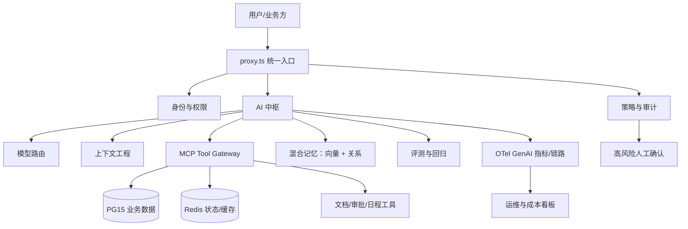

# YYC³ Smart-Office 项目规划 — 智能应用前沿技术与后续规划

> **_YYC³_**（YanYuCloudCube™ · 注册商标）
> _言启象限 | 语枢未来_
> **_Words Initiate Quadrants, Language Serves as Core for Future_**
> _万象归元于云枢 | 深栈智启新纪元_
> **_All things converge in cloud pivot; Deep stacks ignite a new era of intelligence_**

---

## 核心理念

**五高架构**：高可用 | 高性能 | 高安全 | 高扩展 | 高智能
**五标体系**：标准化 | 规范化 | 自动化 | 可视化 | 智能化
**五化转型**：流程化 | 数字化 | 生态化 | 工具化 | 服务化
**五维评估**：时间维 | 空间维 | 属性维 | 事件维 | 关联维

---

## 一、调研范围与凭据

本规划通过实时检索获取智能应用同类系统的前沿技术核心指导，检索日期为 2026-11-20。只采用官方规范与可核验行业资料，不编造内部接口、服务或配置。

| 来源 | 核心结论 | 对本项目启示 |
| ---- | ---- | ---- |
| MCP 官方文档 `https://modelcontextprotocol.io/llms.txt` | Host/Client/Server 架构；Tools/Resources/Prompts 原语；stdio 与 Streamable HTTP 传输；OAuth 2.1 授权；能力发现与安全实践 | 把 AI 助手从“单模型调用”升级为“受治理的工具/上下文网关” |
| A2A 官方站 `https://google.github.io/A2A/` | 面向不透明智能体通信与协作的开放协议，强调能力发现、任务/消息互操作 | 预留跨智能体协作边界，不立即引入复杂多智能体 |
| OWASP LLM Applications Top 10 2025 `https://owasp.org/www-project-top-10-for-large-language-model-applications/` | 提示注入、敏感信息泄露、供应链、投毒、输出处理、过度代理、系统提示泄露、向量弱点、幻觉、无界消耗 | 建立 Agent 安全基线与高风险操作人工审批 |
| OpenTelemetry GenAI SemConv `https://opentelemetry.io/docs/specs/semconv/gen-ai/` | 覆盖 Spans、Agent spans、Events、Metrics、Exceptions 与 MCP；默认避免记录敏感 Prompt/输出 | AI 服务必须可观测、可归因、可审计 |
| 行业趋势检索 | 混合记忆（向量 + 图）、上下文工程、模型路由、确定性评测成为生产 Agent 分水岭 | 从“能回答”转向“可评测、可控制、可降级” |

> 行业趋势资料仅作为方向参考；MCP、A2A、OWASP、OpenTelemetry 作为规范依据。

## 二、当前项目与前沿能力的差距

| 能力 | 当前状态 | 差距 |
| ---- | ---- | ---- |
| AI 服务 | `lib/ai-service.ts` 支持 provider 链、缓存、限流、mock fallback | 无统一工具协议、无上下文工程、无评测集 |
| 数据底座 | PG15 + Redis 自研架构，Drizzle ORM | 未启用向量/图混合检索；缓存策略未量化 |
| 安全 | 传统 Web 安全已加固，生产依赖零已知漏洞 | 未系统化覆盖 OWASP LLM 十大风险 |
| 可观测性 | `/api/health`、日志、K8s 探针 | 缺模型调用链、token 成本、工具成功率与 Agent 步骤指标 |
| 协作治理 | 严格 CI/CD、覆盖率门禁 | 发布周期、责任人、告警链、审批矩阵待确认 |
| 架构表达 | 已新增图标可视架构与 Mermaid 视图 | 需把 AI 中枢演进为受治理的工具网关 |

## 三、目标架构

约束：不引入 Supabase/Firebase 等 BaaS；不替换 PG15 + Redis 自研数据架构；所有密钥通过环境变量/Secret 注入；保持单向依赖，不引入循环依赖。

## 四、分阶段规划

时间采用 `T` = 团队批准本规划之日，具体日期由责任人确认。

### 阶段 P0：止险与治理补全（T+0 至 T+2 周）

| 任务 | 完成标准 |
| ---- | ---- |
| 确认静态导出用途、生产 Secret 托管、发布周期与责任矩阵 | C-04/C-03/C-05 书面确认 |
| 日志敏感字段脱敏 | 密码、token、csrfToken、密钥字段零明文输出；有测试 |
| 全量 API 鉴权审计 | 所有受保护路由有签名/权限校验证据 |
| pre-commit 密钥扫描与类型检查 | 故意提交测试密钥能被拦截 |
| 7 项 skipped 用例定性与 13 条 warning 清理 | skipped 全有结论，warning 清零或登记 |
| 生成 SLO 与压测基线 | P95/P99、RPO/RTO、容量模型书面确认 |

### 阶段 P1：AI 安全与可观测性（T+2 至 T+6 周）

| 任务 | 完成标准 |
| ---- | ---- |
| 建立 OWASP LLM Top 10 对照表 | 10 类风险均有控制措施或风险接受 |
| 引入 GenAI 可观测性 | 模型/工具/Agent spans、token 指标、错误与延迟看板 |
| 建立评测集与确定性回归 | 核心问答/工具调用场景有通过标准和失败判定 |
| 实现上下文工程最小闭环 | 只注入必要上下文；输出带引用/来源；敏感内容默认脱敏 |
| 统一缓存与 CSRF 多实例策略 | Redis 缓存命中率、降级告警与一致性测试通过 |

### 阶段 P2：MCP Tool Gateway（T+6 至 T+12 周）

| 任务 | 完成标准 |
| ---- | ---- |
| 以只读工具先行接入 MCP 思路 | 文档检索、日程查询、组织查询等工具具备输入/输出 schema |
| 工具权限最小化 | 工具白名单、参数校验、超时、配额、审计日志 |
| 高风险操作人工确认 | 审批、删除、发信等动作必须 HITL |
| 模型路由与成本预算 | 简单任务走低成本模型，复杂任务走强模型；有预算告警 |
| 不替换 PG15 + Redis | 新增能力以扩展方式接入，不迁移数据底座 |

### 阶段 P3：A2A 与混合记忆（T+12 周后，待确认）

| 任务 | 完成标准 |
| ---- | ---- |
| A2A 互操作预留 | 能力描述、任务状态、消息协议有适配层设计 |
| 混合记忆评估 | 在 PG15 上评估向量扩展与关系图谱可行性，结果书面确认 |
| 多智能体协作 | 仅在单智能体稳定性与评测达标后启动 |
| 业务闭环自动化 | 审批、日程、文档、客户跟进等形成可审计工作流 |

## 五、验收与风险

| 风险 | 控制 |
| ---- | ---- |
| 过度代理 | 最小权限、工具白名单、HITL、审计日志 |
| 提示注入 | 不可信内容隔离、输出校验、工具参数白名单 |
| 敏感信息泄露 | 默认脱敏、日志过滤、访问控制、Dlp 输出检查 |
| 供应链 | 依赖锁定、审计门禁、SBOM/AI BOM 评估 |
| 幻觉 | RAG 引用、事实核验、人工复核关键结论 |
| 无界消耗 | 限流、配额、token 上限、预算告警、熔断 |
| 架构复杂度失控 | 单包边界、单向依赖、分阶段落地，不一次性全量改造 |

**放行条件**：P0 全部完成；P1 至少具备评测与可观测性最小闭环；任何高风险 Agent 能力必须有人工确认与回滚方案。

---

## 变更历史

| 版本 | 日期 | 变更内容 | 作者 |
| ---- | ---- | -------- | ---- |
| v1.0.0 | 2026-11-20 | 基于前沿技术检索形成智能应用后续规划 | YYC³ Team |

---

  <b>YYC³</b>（YanYuCloudCube™ · 注册商标） 
  言启象限 | 语枢未来 
  <i>Words Initiate Quadrants, Language Serves as Core for Future</i> 
  万象归元于云枢 | 深栈智启新纪元 
  <i>All things converge in cloud pivot; Deep stacks ignite a new era of intelligence</i> 
  © 2026 YanYuCloudCube™（YYC³）· <a href="mailto:admin@0379.email">admin@0379.email</a>

